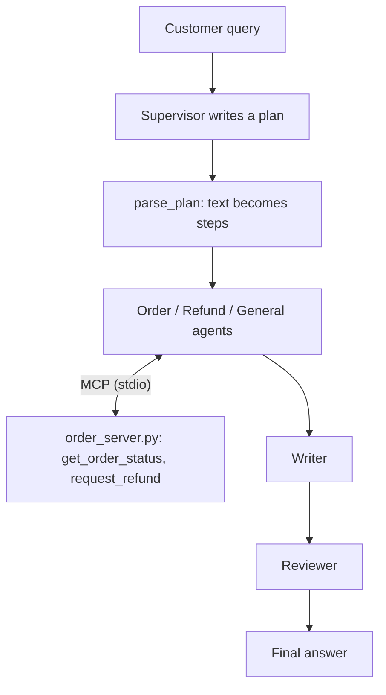

# Smart Support Agent

A customer support agent built step by step with Python, LangChain and Google Gemini.
It reads a customer query, uses tools to get real order data, and answers the customer.

The same idea is built in several ways, from a plain workflow up to a multi-agent system with tools served over MCP, so the differences are easy to see.

## What it can do

- Find the intent of a query and route it to the right agent.
- Check order status and request refunds through tools.
- Break a multi-step query into a plan and run it.
- Use several specialist agents, each with only the tools it needs.
- Load tools from a separate MCP server.
- Review its own answer before replying.

## Learning path

| # | File | Pattern | Who decides the path |
|---|---|---|---|
| 1 | `main.py` | Prompt chaining, routing, tool use, reflection (Gemini SDK) | Code (`if/elif`) |
| 2 | `langchain_version/main_branch.py` | Routing with `RunnableBranch` | Code |
| 3 | `langchain_version/main_tools.py` | Tool-calling agent | The LLM chooses tools |
| 4 | `langchain_version/main_combined.py` | Routing + tools + reflection | Code picks the agent, the LLM picks tools |
| 5 | `langchain_version/main_plan_simple.py` | Planning | The LLM writes a plan, then steps run |
| 6 | `langchain_version/main_planning.py` | Planning + routing + tools | Plan, then routing per step |
| 7 | `langchain_version/main_multi_agent_plan.py` | Multi-agent, plan first | Supervisor writes a plan, code runs it |
| 8 | `langchain_version/main_multi_agent_supervisor.py` | Multi-agent, agents as tools | Supervisor LLM calls agents itself |
| 9 | `langchain_version/main_mcp_multi_agent.py` + `order_server.py` | Multi-agent with MCP | Same as 7, tools come from an MCP server |

Each version has its own notes:

- [Planning version](langchain_version/README_plan_simple.md)
- [Multi-agent: plan vs supervisor](langchain_version/README_multi_agent.md)
- [MCP version](langchain_version/README_mcp.md)

## Patterns used

- **Prompt chaining**: the output of one prompt feeds the next.
- **Routing**: a request goes to the right handler by intent.
- **Tool use**: order status and refund are plain functions exposed as tools.
- **Reflection**: a reviewer improves the final answer.
- **Planning**: the query is split into steps before anything runs.
- **Multi-agent**: a supervisor works with specialist agents.
- **MCP**: tools live in a separate server and are loaded by the agent.

## Workflow vs agent

- **Workflow**: my code decides the path. Predictable and cheap, good for fixed tasks.
- **Agent**: the LLM decides which tool to call and how many times. Flexible, but less predictable.
- **Multi-agent**: a supervisor splits the work between specialist agents. Routing or a plan sets the boundaries, and each agent chooses its own tools inside them.

## Latest architecture (version 9)



Each agent only has the tools it needs. The Order Agent cannot issue refunds because it has no refund tool, and the refund rules are enforced inside the tool code, not in a prompt.

## Project structure

```
smart-support-agent/
├── main.py                           # original version (Gemini SDK)
├── requirements.txt                  # for main.py
├── README.md
├── .gitignore
└── langchain_version/
    ├── main_branch.py
    ├── main_tools.py
    ├── main_combined.py
    ├── main_plan_simple.py
    ├── main_planning.py
    ├── main_multi_agent_plan.py
    ├── main_multi_agent_supervisor.py
    ├── main_mcp_multi_agent.py
    ├── order_server.py               # MCP server
    ├── requirements.txt              # for the LangChain versions
    ├── README_plan_simple.md
    ├── README_multi_agent.md
    └── README_mcp.md
```

## Setup

1. Clone the repo and go into the folder.

   ```bash
   git clone https://github.com/asadchughtai08/smart-support-agent.git
   cd smart-support-agent
   ```

2. Create and activate a virtual environment.

   ```bash
   python3 -m venv venv
   source venv/bin/activate
   ```

3. Install the packages.

   ```bash
   pip install -r langchain_version/requirements.txt
   ```

   For the original `main.py` use `pip install -r requirements.txt` instead.

4. Create a `.env` file in the project root with your Gemini key.

   ```
   GEMINI_API_KEY=your_key_here
   ```

5. Run a version.

   ```bash
   python langchain_version/main_mcp_multi_agent.py
   ```

   Replace the file name to run any other version.

## Try these queries

| Query | What to look for |
|---|---|
| `Where is order 1234?` | Order status through a tool |
| `Refund order 1236` | The order is Delivered, so the refund is created |
| `Order 1234 late hai, refund do` | Status check first, then the refund is rejected (Shipped) |
| `My app is not working` | A general answer, no tool |

## Limitations

- Order data is a fake dictionary, not a database.
- One wrong intent or plan sends the work to the wrong place.
- LLM output is not deterministic, so results can differ between runs.
- More agents mean more LLM calls, so higher cost and latency.
- The model name (`gemini-3.5-flash-lite`) may differ for your account. Change it at the top of each file if you get a model error.

## Future improvements

- Re-plan when a step fails, and validate plans before running them.
- Move the agents to LangGraph for loops, memory and human approval before refunds.
- Replace the dictionary with a real database behind the MCP server.
- Add automated tests for intents, plans and tools.
- Add logging and tracing.

## Tech stack

Python, LangChain, langchain-google-genai, langchain-mcp-adapters, MCP (FastMCP), Google Gemini, python-dotenv.
