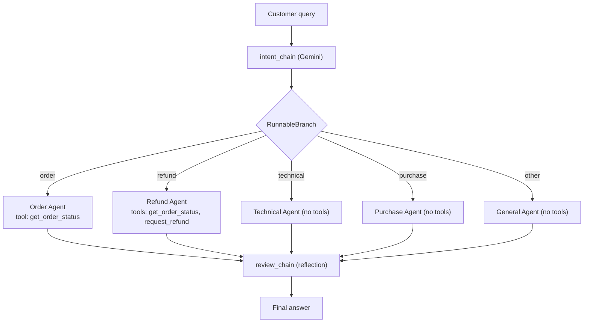

# Smart Support Agent

A small customer support agent built with Python and Google Gemini.
It reads a customer query, finds the intent, routes the request to the right agent, uses tools to get real order data, and reviews its own answer before replying.

The same idea is built **four ways**, so you can compare a plain workflow with a real tool-calling agent.

## Versions

| Version | File | Who decides the path? |
|---|---|---|
| 1. Original (Gemini SDK) | `main.py` | Code (`if/elif` routing) |
| 2. LangChain routing | `langchain_version/main_branch.py` | Code (`RunnableBranch`), fixed workflow |
| 3. LangChain tools | `langchain_version/main_tools.py` | The LLM chooses tools itself (real agent) |
| 4. Combined | `langchain_version/main_combined.py` | Code picks the agent, the LLM picks the tools |

## Patterns used

- **Prompt chaining**: the output of one prompt feeds the next.
- **Routing**: the request is sent to the right handler by intent.
- **Tool use**: order status and refund are plain Python functions exposed as tools.
- **Reflection**: a final prompt reviews and improves the answer.

## How the combined version works



1. `intent_chain` asks Gemini for a one-word intent (`order_tracking`, `refund`, ...).
2. `RunnableBranch` picks the agent from the intent.
3. Agents with tools run a loop: Gemini asks for a tool, the code runs it, the result goes back to Gemini, until Gemini gives a final answer (maximum 5 rounds).
4. `review_chain` reviews the answer and returns the improved version.

Each agent only gets the tools it needs. The Order Agent cannot issue refunds because it has no refund tool.

## Example

Query: `Order 1234 late hai, refund do`

1. Intent: `refund`
2. Routed to: Refund Agent
3. Gemini calls `get_order_status("1234")`, result `Shipped`
4. Gemini calls `request_refund("1234")`, result `Refund not possible. Order status is Shipped.`
5. Gemini explains this to the customer, then the reflection step polishes the reply.

The exact tool order can vary, because the LLM decides it.

## Project structure

```
smart-support-agent/
├── main.py                      # original version (Gemini SDK)
├── requirements.txt             # for main.py
├── README.md
├── .gitignore
└── langchain_version/
    ├── main_branch.py           # routing with RunnableBranch
    ├── main_tools.py            # tool-calling agent
    ├── main_combined.py         # routing + tools + reflection
    └── requirements.txt         # for the LangChain versions
```

## Setup

1. Clone the repo and go into the folder.

   ```bash
   git clone https://github.com/asadchughtai08/smart-support-agent.git
   cd smart-support-agent
   ```

2. Create and activate a virtual environment.

   ```bash
   python3 -m venv venv
   source venv/bin/activate
   ```

3. Install the packages.

   ```bash
   pip install -r langchain_version/requirements.txt
   ```

   For the original `main.py` use `pip install -r requirements.txt` instead.

4. Create a `.env` file in the project root with your Gemini key.

   ```
   GEMINI_API_KEY=your_key_here
   ```

5. Run a version.

   ```bash
   python langchain_version/main_combined.py
   ```

## Try these queries

| Query | What to look for |
|---|---|
| `Where is order 1234?` | Order Agent calls `get_order_status` |
| `Refund order 1236` | Refund Agent, order is Delivered so the refund is created |
| `Order 1234 late hai, refund do` | Status check first, then the refund is rejected (Shipped) |
| `My app is not working` | Technical Agent, no tool is called |

## Workflow vs agent

- **Workflow** (`main_branch.py`): the code decides the path. Predictable and cheap, good for fixed tasks.
- **Agent** (`main_tools.py`): the LLM decides which tool to call and how many times. Flexible, but less predictable.
- **Combined**: routing sets the boundaries and the LLM chooses tools inside them. It uses more LLM calls (about 4 to 5 per request) in exchange for safety and flexibility.

## Limitations

- Order data is a fake dictionary, not a database.
- One wrong intent sends the request to the wrong agent.
- LLM output is not deterministic, so results can differ between runs.
- Only one agent handles a request, so a query that needs two departments is not split.
- The model name (`gemini-3.5-flash-lite`) may differ for your account. Change it at the top of each file if you get a model error.

## Future improvements

- Move the agents to LangGraph for loops (retry after reflection), memory, and human approval before refunds.
- Replace the dictionary with a real database.
- Add automated tests for intents and tools.
- Add logging and tracing.

## Tech stack

Python, LangChain, langchain-google-genai, Google Gemini, python-dotenv.
