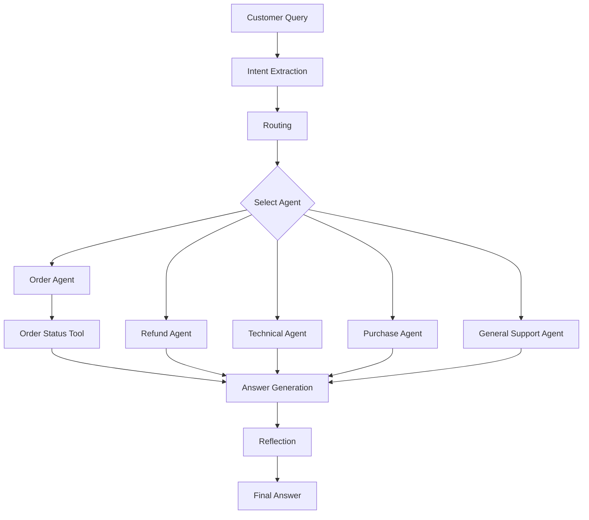

# 🤖 Smart Support Agent

An AI-powered customer support application built using Python and Google's Gemini API. This project demonstrates basic Agentic AI design patterns, including Prompt Chaining, Intent Extraction, Routing, Tool Use, and Reflection.

## 🚀 Project Overview

The Smart Support Agent receives customer queries, identifies their intent, selects the appropriate support agent, and generates a helpful response.

For order tracking queries, the application uses a simple Python tool to retrieve order status from sample order data.

## ✨ Features

- **Intent Extraction:** Identifies the customer's query category using Gemini.
- **Routing:** Selects the appropriate support agent based on intent.
- **Tool Use:** Executes a Python function to check order status.
- **Prompt Chaining:** Uses multiple AI prompts in sequence.
- **Answer Generation:** Generates friendly and helpful customer responses.
- **Reflection:** Reviews the generated answer for correctness and helpfulness.
- **Error Handling:** Uses the original answer if the reflection step fails.

## 🧠 Architecture



## 🛠️ Technologies Used

- Python
- Google Gemini API
- Google GenAI SDK
- python-dotenv
- Regular Expressions

## 📂 Project Structure

```text
smart-support-agent/
│
├── main.py
├── requirements.txt
├── README.md
├── .env.example
├── .gitignore
└── .env
```

## ⚙️ Installation

### 1. Clone the Repository

```bash
git clone https://github.com/asadchughtai08/smart-support-agent.git
```

### 2. Navigate to the Project

```bash
cd smart-support-agent
```

### 3. Create a Virtual Environment

```bash
python -m venv venv
```

### 4. Activate the Virtual Environment

Linux / Ubuntu:

```bash
source venv/bin/activate
```

### 5. Install Dependencies

```bash
pip install -r requirements.txt
```

## 🔑 API Configuration

Create a `.env` file in the project directory.

Add your Gemini API key:

```env
GEMINI_API_KEY=your_api_key_here
```

Never upload your actual API key to GitHub.

## ▶️ Usage

Run the application:

```bash
python main.py
```

Enter a customer query when prompted.

### Example

**Input:**

```text
Where is my order 1234?
```

**Output:**

```text
--- STEP 1: INTENT EXTRACTION ---
Intent: order_tracking

--- STEP 2: ROUTING ---
Selected Agent: Order Agent

--- STEP 3: TOOL RESULT ---
Order Status: Shipped

--- STEP 4: FINAL ANSWER ---
Hi there! I'd be happy to help.
Your order #1234 has been shipped!

--- STEP 5: REFLECTION ---
Your order #1234 has been shipped.
```

## 📚 Agentic AI Concepts Demonstrated

| Concept | Description |
|---|---|
| Prompt Chaining | Passing outputs from one prompt to another |
| Intent Extraction | Understanding the customer's query |
| Routing | Selecting the appropriate support agent |
| Tool Use | Executing a Python function to retrieve order status |
| Reflection | Reviewing and improving the generated response |
| Exception Handling | Managing API errors without crashing the application |

## 🔮 Future Improvements

- Dynamic order ID extraction
- Conversation memory
- Improved error handling
- More customer support tools
- FastAPI backend
- Web-based user interface
- Database integration

## ⚠️ Disclaimer

This project is a learning-focused prototype.

Order information is stored in a local Python dictionary and is not connected to a real order management system.

## 👨‍💻 Author

Asad Ullah Chughtai

AI Engineer | Agentic AI & Generative AI

---

⭐ If you find this project useful, feel free to star the repository!