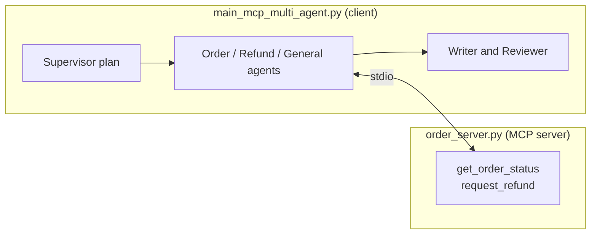

# MCP Multi-Agent: Tools in a Separate Server

This version takes the plan-based multi-agent system (`main_multi_agent_plan.py`) and moves its tools into an **MCP server**.
The agent logic stays the same. Only the **source of the tools** changes.

| File | Role |
|---|---|
| `order_server.py` | MCP **server**: order data and the tools `get_order_status` and `request_refund` |
| `main_mcp_multi_agent.py` | MCP **client**: loads the tools from the server and runs the multi-agent system |

## What is MCP

The Model Context Protocol is a standard way for an AI application to use tools that live outside of it.
A tool server exposes tools, and any MCP client can list and call them.
So the same tools can be shared by many agents or apps, and changed without touching the agent code.

## What changed

|  | Before (`main_multi_agent_plan.py`) | Now (`main_mcp_multi_agent.py`) |
|---|---|---|
| Where the tools live | In the same file (`@tool`) | In `order_server.py` (`@mcp.tool()`) |
| Order data | In the same file | In the server |
| How tools are obtained | Direct functions | `await mcp_client.get_tools()` |
| Calling a tool | `.invoke()` | `await ... .ainvoke()` |
| Code style | Sync | Async (`async def`, `await`, `asyncio.run`) |

The planner, agents, shared log, writer and reviewer are unchanged.

## Architecture



The client starts the server as a subprocess and talks to it over standard input and output (stdio), so no port or URL is needed.

## Flow

Query: `Order 1234 late hai, refund do`

```
0. get_tools()          -> the server starts, the client receives 2 tools
1. plan_chain           -> 1. order | check status   2. refund | request refund
2. Order Agent          -> Gemini asks for get_order_status("1234")
                           client calls the MCP server -> "Shipped"
3. Refund Agent         -> reads the shared log, Gemini asks for request_refund("1234")
                           client calls the MCP server -> "Refund not possible (Shipped)"
4. Writer               -> friendly reply from the log
5. Reviewer             -> improved reply
```

The number of LLM calls is about the same as the non-MCP version (around 7 for this query). MCP does not add LLM calls, it only changes how tools are reached.

## How the pieces work

**Server (`order_server.py`)**
- `FastMCP("OrderServer")` creates the server.
- `@mcp.tool()` turns a function into an MCP tool. Its docstring becomes the description the model sees.
- `mcp.run(transport="stdio")` waits for the client.
- Business rules live here. For example, `request_refund` only allows `Delivered` orders, whatever the client or prompt says.

**Client (`main_mcp_multi_agent.py`)**
- `MultiServerMCPClient` is told how to start the server and which transport to use.
- `get_tools()` returns the server's tools as LangChain tools.
- `AGENT_TOOLS` gives each agent only the tools it needs: the Order Agent gets `get_order_status`, the Refund Agent gets both.
- Results from MCP tools can be text or a list of content blocks, so `get_text()` turns them into plain text before they go back to the model.

## Setup and run

From the repo root, with the virtual environment active and `GEMINI_API_KEY` in `.env`:

```bash
pip install -r langchain_version/requirements.txt
python langchain_version/main_mcp_multi_agent.py
```

You do not start the server yourself. The client starts it.

First check: under `STEP 0` you should see the tool names:

```
Tools mile: ['get_order_status', 'request_refund']
```

Then try:

| Query | What to look for |
|---|---|
| `Where is order 1234?` | Only the Order Agent runs, tool call goes to the server |
| `Order 1234 late hai, refund do` | Order Agent first, then Refund Agent with its result |
| `Refund order 1236` | Order is Delivered, so the refund is created |
| `My app is not working` | General Agent only, no MCP call |

## Things to know

- **Async is required.** The tools from the adapter are async, so the whole loop uses `ainvoke` and `await`.
- **No normal `print()` in the server.** With stdio, standard output carries the protocol messages. The server logs to standard error instead.
- **A new session may start for each tool call**, so the server can be started repeatedly. This is fine for this read-only fake data.
- **The MCP packages in LangChain are changing.** This project uses `langchain-mcp-adapters`. LangChain also has a newer built-in MCP support that was in beta when this was written, so check the current docs if you migrate. Only the part that creates the client and loads the tools would need to change.
- **Schema errors:** if Gemini rejects a tool schema, check the error text and the tool's argument types.

## Limitations

- The data is a fake dictionary, not a database.
- The client decides which agent gets which tool. For real security, also enforce permissions on the server side.
- Errors from the server or the tools are not handled yet, except in the reviewer step.
- `shared_state` is not cleared between requests, so it suits one request per run.

## Next steps

- Convert the supervisor-as-tools version the same way.
- Add error handling and retries around tool calls.
- Use HTTP transport with authentication for a shared server.
- Connect the server to a real database.
