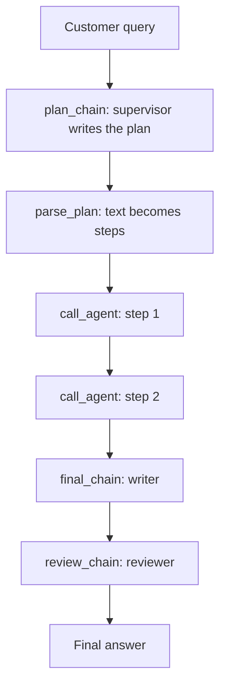
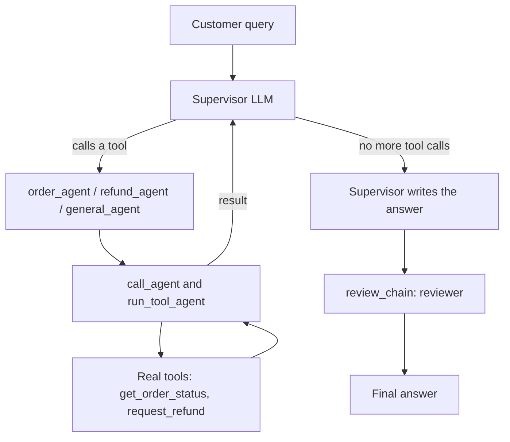

# Multi-Agent Support System: Plan vs Supervisor

Two versions of the same customer support system, built with LangChain and Gemini.
Both use the same three specialist agents. The only difference is **who decides which agent runs, and when**.

| File | Approach |
|---|---|
| `main_multi_agent_plan.py` | **Plan first.** The supervisor writes a text plan, and my code runs it. |
| `main_multi_agent_supervisor.py` | **Supervisor as an agent.** The supervisor calls agents as tools, one at a time. |

## The shared parts

Both files contain the same building blocks:

| Part | Job |
|---|---|
| Order Agent | Checks order status. Tool: `get_order_status` |
| Refund Agent | Checks status, then requests a refund. Tools: `get_order_status`, `request_refund` |
| General Agent | Technical problems and other questions. No tools |
| `call_agent()` | Runs a specialist agent and writes its work to the shared log |
| `run_tool_agent()` | The tool-calling loop of one agent (maximum 5 rounds) |
| `shared_state["log"]` | Work done so far, which the next agent can read |
| `review_chain` | Reviewer that improves the final answer |

Safety is the same in both: each agent only has its own tools, and the refund rules are enforced inside `request_refund` in code, not in a prompt.

## The key difference

|  | Plan version | Supervisor version |
|---|---|---|
| Who runs the agents | **My code** | **The supervisor LLM** |
| How the supervisor works | Writes a text plan, one `agent \| task` per line | Calls agent tools and reads each result |
| `@tool` wrappers around agents | No | Yes (`order_agent`, `refund_agent`, `general_agent`) |
| Agent description lives in | The planner prompt | The tool docstring |
| `parse_plan()` | Yes | No |
| Writer step | `final_chain` writes the reply | The supervisor writes the reply |
| Plan visible before running | Yes | No |
| Reacts to a surprising result | No, the plan is fixed | Yes, decides after each result |
| Predictability | High | Lower |
| LLM calls for a two-step request | About 7 | About 8 |

In one sentence: in the plan version the LLM **writes** the plan and my code **runs** it. In the supervisor version the LLM **runs** the agents itself.

## Plan version flow



Each `call_agent` adds its result to the shared log, so step 2 can see what step 1 found.

## Supervisor version flow



The supervisor sees every result in its message history and decides the next agent.

## Example

Query: `Order 1234 late hai, refund do`

**Plan version**

```
Plan:   1. order  | Check the status of order 1234
        2. refund | Request a refund for order 1234 if allowed
Order Agent  -> get_order_status("1234") -> Shipped
Refund Agent -> reads the log, request_refund("1234") -> not possible (Shipped)
Writer       -> friendly reply from the log
Reviewer     -> improved reply
```

**Supervisor version**

```
Supervisor -> order_agent("Check status of order 1234")    -> Shipped
Supervisor -> refund_agent("Refund order 1234 if allowed") -> not possible (Shipped)
Supervisor -> writes the reply
Reviewer   -> improved reply
```

The exact steps can change between runs, because an LLM makes the decisions.

## Which one to use

**Plan version** when you want control and a visible plan, and the task is clear and multi-step. It is easier to inspect and debug.

**Supervisor version** when the next step depends on the previous result and the path may change. It is more flexible, but less predictable.

## Run

From the repo root, with the virtual environment active and `GEMINI_API_KEY` in `.env`:

```bash
python langchain_version/main_multi_agent_plan.py
python langchain_version/main_multi_agent_supervisor.py
```

Try the same queries on both and compare:

| Query | What to look for |
|---|---|
| `Where is order 1234?` | Only the Order Agent runs |
| `Order 1234 late hai, refund do` | Order Agent first, then Refund Agent using its result |
| `My app is not working` | Only the General Agent, no tools |

## Limitations

- Several LLM calls per request, so higher cost and latency than a single agent.
- The plan version does not re-plan if a step fails.
- The supervisor version can pick the wrong agent, so docstrings must be clear.
- `shared_state` is not cleared between requests, so it suits one request per run.
- Order data is a fake dictionary, not a database.

## Next steps

- Re-plan when a step fails.
- Move the tools behind an MCP server.
- Rebuild the flow in LangGraph for loops, memory and human approval.
